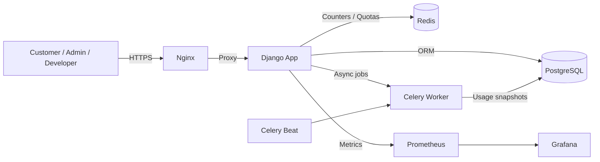

# MeterFlow

MeterFlow is a modular monolithic SaaS platform for API gateway usage metering, subscription management, rate limiting, and billing. The initial Phase 1 foundation establishes the architecture, boundaries, deployment model, and development workflow required for a production-oriented product.

## Phase 1 deliverables

- System architecture overview
- Django project structure
- App responsibility boundaries
- Database relationship overview
- Docker Compose service topology
- Compatible initial dependency versions
- Environment variable design
- Security baseline
- Windows PowerShell setup and verification checklist

## Architecture summary

MeterFlow uses a modular monolith with a clean separation of responsibilities:

- Django provides the application layer and API surface.
- PostgreSQL stores durable business data and audit records.
- Redis handles hot-path counters and rate limiting.
- Celery processes asynchronous usage aggregation and billing jobs.
- Nginx exposes services behind a clean reverse-proxy boundary.
- Prometheus and Grafana provide operational observability.

## High-level architecture



## Repository structure

```text
meterflow/
├── apps/
├── config/
├── core/
├── docs/
├── docker/
├── requirements/
├── scripts/
├── tests/
├── .env.example
├── .dockerignore
├── .gitignore
├── Dockerfile
├── Dockerfile.nginx
├── docker-compose.yml
├── manage.py
├── README.md
├── pyproject.toml
└── requirements.txt
```

## Design principles

1. Multi-tenancy is enforced at the service layer and queryset layer.
2. Tenant identity is derived from validated credentials, never from client input.
3. Redis is for transient, hot-path counters; PostgreSQL remains the source of truth.
4. Usage aggregation is asynchronous and idempotent.
5. Billing logic reads durable usage records, not live Redis counters.
6. Audit logs are append-only and security-sensitive.
7. Production code should be testable and observable.

## Phase 1 verification checklist

- [ ] Django project boots and loads settings correctly
- [ ] PostgreSQL service is healthy
- [ ] Redis is reachable
- [ ] Celery can import without runtime errors
- [ ] .env example is complete and safe
- [ ] Project boundaries are clear and modular
- [ ] Docker Compose environment starts cleanly
- [ ] Architecture documentation is available in docs/

## Local Windows PowerShell setup

```powershell
python -m venv .venv
. .\.venv\Scripts\Activate.ps1
python -m pip install --upgrade pip setuptools wheel
pip install -r requirements\dev.txt
Copy-Item .env.example .env
python manage.py migrate
python manage.py runserver 0.0.0.0:8000
```

## Notes

This is the foundational Phase 1 implementation. It intentionally avoids shipping full billing logic or gateway behavior. The next phase focuses on tenant ownership, auth, and permissions before API key and gateway logic are added.
